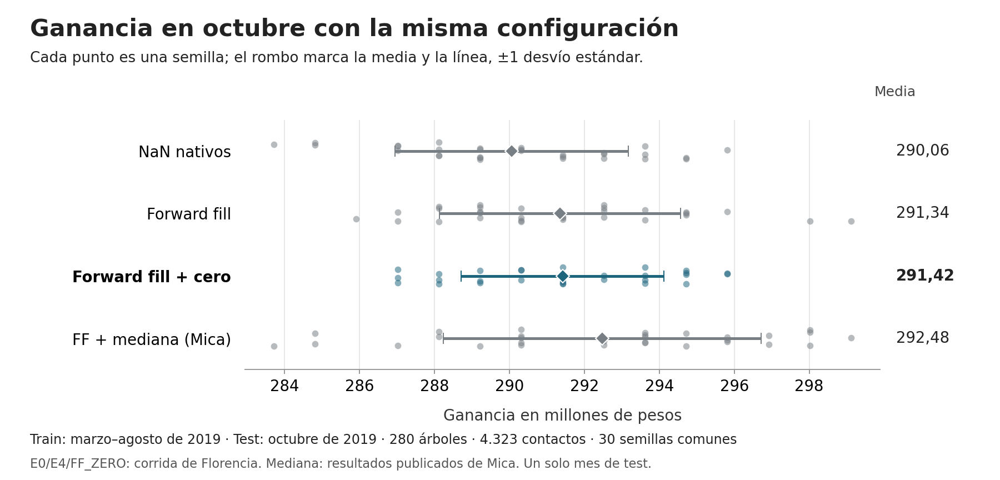

# Forward fill + cero: experimento de imputación

Experimento de **Florencia Rodríguez** para Data Mining en Economía y Finanzas, edición 2026.

La pregunta es si completar con **cero los faltantes que sobreviven al forward fill causal por cliente** mejora la ganancia de una campaña. No equivale a imputar todos los faltantes con cero: primero se conserva el último valor observado de cada cliente y variable.

**Resultado:** FF + cero alcanza una ganancia media de **291,42 millones de pesos**. Mejora el AUC frente a NaN nativos y forward fill, pero su ventaja económica no es concluyente después del ajuste de Holm.

## Diseño

- Entrenamiento final: marzo–agosto de 2019. Test: octubre de 2019.
- 30 semillas comunes por método. La tabla alineada combina 90 entrenamientos locales de E0/E4/FF_ZERO y 30 evaluaciones publicadas por Mica. La corrida local original tuvo 120 entrenamientos, incluido un control de mediana distinto, conservado en el archivo histórico.
- LightGBM, 280 árboles, N = 4.323 contactos e hiperparámetros congelados de Exp1. Sin nueva optimización.
- Mismas 150 variables originales y sus lags/deltas, 750 predictores en total.
- Auditoría compartida de ceros mensuales y exclusión de `tmobile_app` y `cmobile_app_trx`.
- Enero/febrero aportan historia para lags. Septiembre aporta historia para octubre. Noviembre/diciembre intervienen solo en la construcción del target de octubre.

Código base de [Agustín Bernacchia](https://github.com/AgustinBerna/experimentos-colaborativos), commit `27d9d941f47b3b0eeaa7c724990baf5361613ce8`.

## Resultados con el control compartido

| Método | Ganancia media, M$ | Desvío, M$ | AUC medio | Ganancia del ensamble, M$ | AUC del ensamble |
|---|---:|---:|---:|---:|---:|
| E0 · NaN nativos | 290,06 | 3,11 | 0,936719 | 287,02 | 0,937506 |
| E4 · Forward fill | 291,34 | 3,22 | 0,936863 | 293,62 | 0,937699 |
| **FF_ZERO · FF + cero** | **291,42** | **2,71** | **0,937238** | **295,82** | **0,938077** |
| FF_MEDIAN_MICA · mediana después de FF | 292,48 | 4,24 | 0,937447 | 294,72 | 0,938251 |

Las medias y desvíos describen los 30 modelos individuales. El ensamble promedia sus probabilidades y es una evaluación distinta; su ganancia no es la media de las ganancias. El ensamble de FF_ZERO captura 377 BAJA+2.



### Comparaciones de FF_ZERO con el control alineado

Wilcoxon bilateral pareado por semilla, con Holm sobre tres comparaciones por métrica.

| Referencia | Diferencia de ganancia media, M$ | p Holm, ganancia | Diferencia de AUC | p Holm, AUC |
|---|---:|---:|---:|---:|
| E0 | +1,357 | 0,1163 | +0,000519 | 0,000566 |
| E4 | +0,073 | 0,9177 | +0,000375 | 0,002076 |
| FF_MEDIAN_MICA | −1,063 | 0,3600 | −0,000208 | 0,119077 |

No hay diferencias de ganancia significativas al 5% entre FF_ZERO y estas referencias. Hay mejora de AUC frente a E0 y E4. No detectar una diferencia no demuestra equivalencia entre métodos.

## Definición de la mediana y cambio del control

La revisión del [código de Micaela](https://github.com/micaelarr/experimentos-colab/blob/main/03_imputar_extra.py), realizada el 17 de noviembre de 2026, confirma una diferencia de definición:

- **Control local FF_MEDIAN:** calcula la mediana sobre las filas auditadas originales de train, antes del forward fill, y luego la aplica a los faltantes residuales.
- **Mica, E10 en su código / E8 en las slides:** calcula la mediana de train sobre el panel después del forward fill.

Ambas definiciones usan solo train. La primera estima la mediana de valores observados. La segunda estima la mediana del panel transformado, contando también los valores arrastrados. No hay superioridad universal. Por ejemplo, observaciones 0 y 100 tienen mediana 50; si forward fill produce 0, 0, 0 y 100, la mediana pasa a 0.

**El 17 de noviembre de 2026 se adoptó la definición de Mica como control común**, para que la comparación del grupo cambie el valor de relleno residual bajo una misma preparación. Se adaptó `ff_variants.py` a calcular la mediana después de FF y se agregó una prueba que distingue los dos órdenes. `FF_ZERO` no cambió.

La tabla actual usa sus 30 resultados E10 publicados en el commit `b4f92dc83ace1a068393c661ecf71c0e9e32d73a`. E0/E4 coinciden con nuestros resultados por semilla en las seis métricas comprobadas, incluidas AUC, ganancia y N. No se reentrenó la mediana en esta actualización ni se verificaron las predicciones individuales de Mica. Su ganancia media es 292,48 M, frente a 292,11 M del control local original. Los cálculos anteriores permanecen en `archivo_corrida_original/`.

El cambio del control ocurrió después de ver octubre. La comparación alineada es **posterior a la corrida original y exploratoria**, no una comparación preespecificada. No se seleccionó un ganador buscando el menor p-valor.

## Reproducir

La corrida original usó Python 3.12.14. Instalar las dependencias de `requirements.txt` en un entorno virtual. LightGBM requiere OpenMP en el sistema.

```sh
python3.12 -m venv .venv
source .venv/bin/activate
python -m pip install -r requirements.txt
python reproducir.py --data /ruta/competencia_02_crudo.csv.gz
python analysis/analizar_resultados.py
```

El [dataset del curso](https://storage.googleapis.com/open-courses/dmeyf2026-9c6f/competencia_02_crudo.csv.gz) se descarga por separado. El comando genera los checkpoints en `run/`; repetirlo permite reanudar con los mismos datos, código y entorno. Los controles existentes de causalidad y relleno se ejecutan antes del entrenamiento. Para correrlos por separado:

```sh
cd experiment
python -m unittest test_ff_variants -v
```

Los resultados agregados ya están incluidos. No hace falta entrenar para leerlos. Para recalcular la tabla alineada a partir de los CSV incluidos, ejecutar `python analysis/alinear_control_mica.py`. `reproducir.py` ejecuta una nueva corrida local con el control adaptado y requiere una carpeta `run/` nueva. No debe mezclarse con los checkpoints históricos.

Los datos, modelos y predicciones individuales no se publican. Para regenerar el gráfico se necesita `matplotlib==3.10.7` y `python analysis/graficar_resultados.py`.

## Archivos

- [Resumen](outputs/resumen_florencia.csv), [120 métricas individuales](outputs/metricas_por_semilla.csv) y [comparaciones pareadas](outputs/comparaciones_pareadas.csv).
- [Procedencia y comprobaciones](outputs/analisis_verificado.json), [reproducción local de E0/E4](outputs/reproduccion_referencia.csv), [protocolo actualizado](protocol.json) y [protocolo original](archivo_corrida_original/protocol.json).
- [Explicación para las slides y el video](docs/presentacion_y_video.md).
- [Cambios de empaquetado y trazabilidad](docs/publicacion.md).

E0 y E4 reprodujeron las métricas publicadas del código base. Las predicciones locales y sus cálculos se verificaron durante la corrida original. La publicación mantiene FF_ZERO, las semillas, los hiperparámetros y los controles de datos. El único cambio de método es el control de mediana documentado arriba.

## Alcance

Las 30 semillas describen variación del modelo sobre los mismos clientes en un solo mes, no 30 muestras temporales independientes. El equipo ya había observado octubre al proponer las variantes. El control se armonizó después de la corrida. La mejora de AUC no garantiza una mejora económica estable ni generalización a otros meses.

Esta prueba complementa las variantes de Mica y los Exp1/Exp2 de Agustín. Es diferente de la prueba de imputación directa con ceros que Agustín propuso posteriormente.
